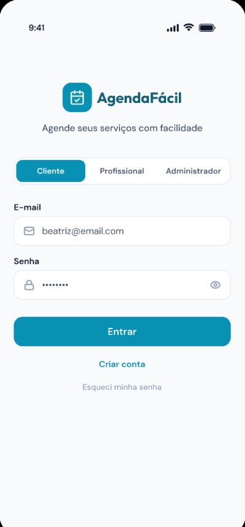
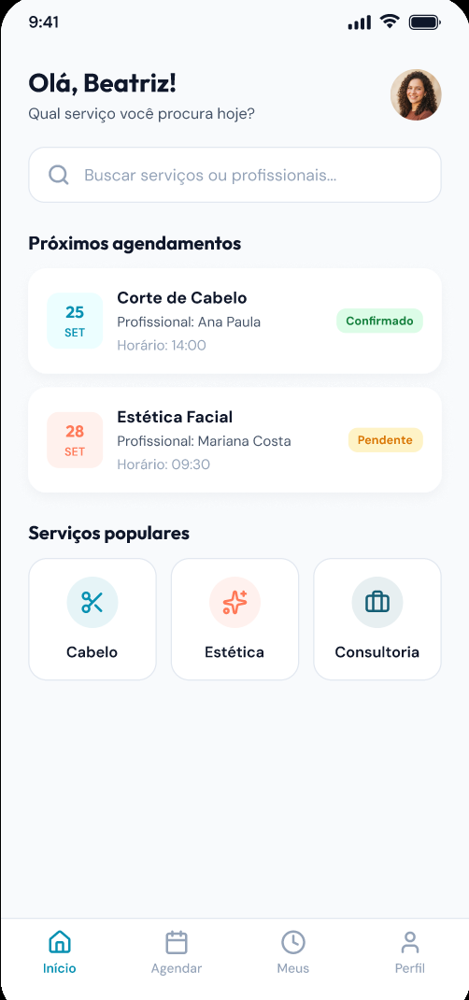
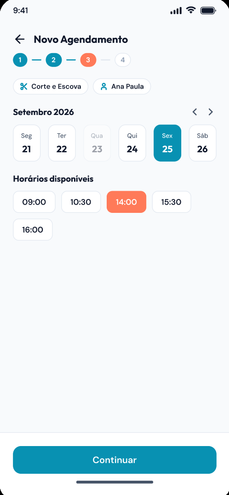
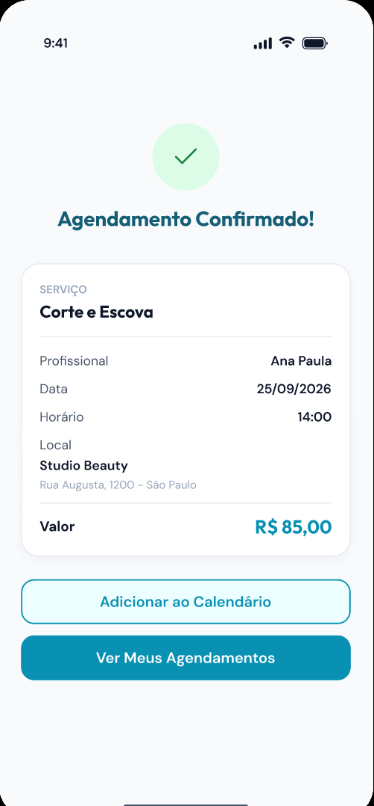
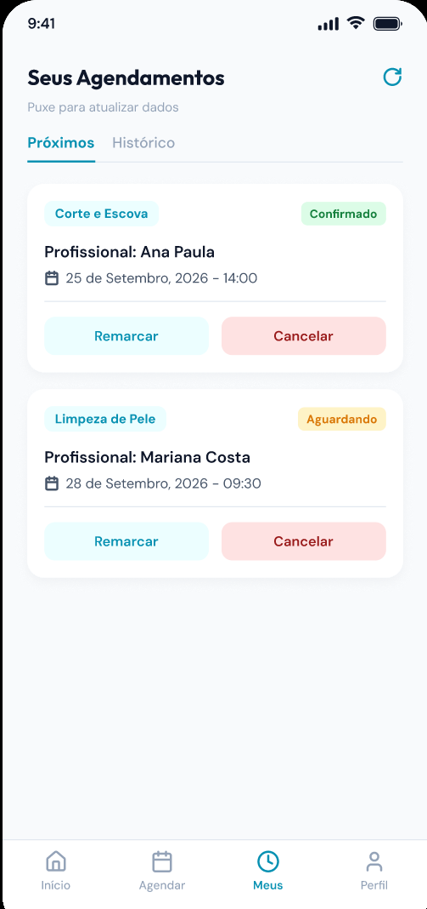
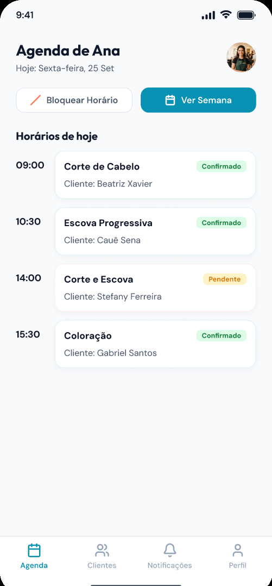
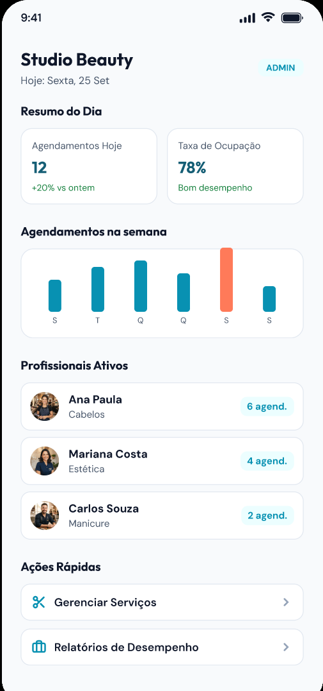
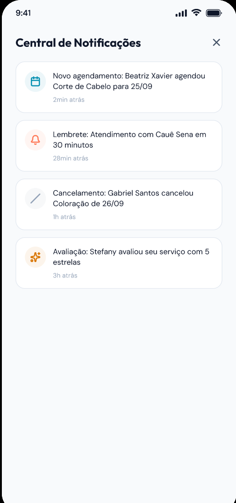

<h1 align="center">📅 Agenda Fácil</h1>

<p align="center">
  Aplicativo Android de agendamento de serviços para salões, clínicas e consultórios,<br>
  com painel do profissional e do administrador.
</p>

<p align="center">
  
  
  
  
  
</p>

<p align="center">
  
  
  
  
  
  
  
  
</p>
<p align="center"><sub>Protótipo do Figma que serviu de base para o layout do aplicativo.</sub></p>

---

## 📌 Sobre o projeto

O **Agenda Fácil** resolve um problema comum em pequenos negócios: agendamentos feitos por mensagem ou caderno, que geram conflitos de horário, esquecimentos e falta de controle.

Com ele, o cliente escolhe o serviço, o profissional, o dia e o horário em poucos toques. O profissional acompanha a própria agenda, e o administrador gerencia serviços, equipe e acompanha os resultados.

O sistema é dividido em duas partes:

| Parte | Tecnologia | Pasta |
|---|---|---|
| **Aplicativo** | Android nativo em Java | [`android/`](android) |
| **API (servidor)** | Spring Boot + MySQL + JWT | [`backend/`](backend) |

## ✨ Funcionalidades

### 👤 Cliente
- Cadastro, login e edição dos próprios dados
- Busca de serviços por nome, categoria ou profissional
- Agendamento em 4 etapas: **serviço → profissional → data e hora → confirmação**
- Calendário com dias e horários realmente livres (dias sem vaga ficam desabilitados)
- Remarcar e cancelar agendamentos, com histórico
- Adicionar o agendamento ao calendário do celular
- Central de notificações (confirmação, lembrete, cancelamento)

### 💼 Profissional
- Agenda do dia e da semana (somente a própria agenda)
- Confirmar, cancelar e registrar atendimentos como realizados
- Bloquear horários (almoço, folga, compromisso)
- Lista de clientes atendidos
- Notificações de novos agendamentos, com contador

### 🛠️ Administrador
- Painel com agendamentos do dia, taxa de ocupação e gráfico semanal
- Cadastro e ativação/desativação de **serviços** e **profissionais**
- Definição dos dias e horários de atendimento de cada profissional
- Relatórios por período (total, status e receita dos atendimentos realizados)

## 🧠 Regras de negócio implementadas

| Regra | Como funciona |
|---|---|
| **RN001** | Somente cliente cadastrado e autenticado agenda |
| **RN002** | Dois agendamentos não podem ocupar o mesmo horário do mesmo profissional (validado no servidor, com trava para evitar disputa simultânea) |
| **RN003** | O cliente só altera ou cancela os próprios agendamentos |
| **RN004** | O profissional só enxerga e altera a própria agenda |
| **RN005** | Apenas o administrador gerencia serviços e profissionais |
| **RN006** | Um atendimento só pode ser registrado como realizado se estiver confirmado e a data já tiver chegado |

Além disso: lembretes automáticos 30 minutos antes do atendimento, senhas criptografadas (BCrypt) e acesso por perfil via token JWT.

## 🧰 Tecnologias

**Aplicativo (Android)**
- Java 17, AppCompat e Material Components
- Retrofit, OkHttp e Gson para comunicação com a API
- Fontes *Outfit* e *DM Sans* (as mesmas do Figma)
- Android 8.0+ (minSdk 26)

**API (servidor)**
- Java 17, Spring Boot 3.3, Spring Web, Spring Data JPA, Bean Validation
- Spring Security + JWT (jjwt)
- MySQL 8 (ou H2 em memória para testes rápidos)
- Maven (wrapper incluído, não precisa instalar)

## 🗂️ Estrutura

```
agenda-facil/
├── DEPLOY.md                         como usar em outros celulares (internet)
├── backend/
│   ├── database/01_schema.sql        modelo físico do banco (opcional)
│   ├── docker-compose.yml            MySQL pronto para uso
│   ├── Dockerfile                    publicação do servidor na nuvem
│   └── src/main/java/br/com/agendafacil/
│       ├── controller/               endpoints REST
│       ├── service/                  regras de negócio
│       ├── repository/               acesso ao banco (JPA)
│       ├── model/                    entidades
│       ├── security/  config/        JWT, CORS, dados iniciais
│       └── dto/  exception/
├── android/app/src/main/java/br/com/agendafacil/app/
│   ├── LoginActivity, RegisterActivity
│   ├── ui/cliente  ui/profissional  ui/admin     uma Activity por perfil
│   ├── ui/common                     base das telas, perfil, notificações
│   ├── ui/                           componentes visuais (Ui, Widgets, Fmt)
│   └── data/                         modelos, API (Retrofit), sessão
└── docs/img/                         telas do protótipo
```

## 🚀 Como executar

### Pré-requisitos
- **JDK 17** ou superior
- **Android Studio** (Koala ou mais novo) com Android SDK 34
- Opcional: **Docker**, para usar MySQL

### 1. Subir o servidor

```bash
cd backend

# Opção A — teste rápido, banco em memória (não precisa de MySQL)
./mvnw spring-boot:run -Dspring-boot.run.profiles=h2        # Windows: .\mvnw.cmd spring-boot:run "-Dspring-boot.run.profiles=h2"

# Opção B — MySQL com Docker (os dados ficam salvos)
docker compose up -d
./mvnw spring-boot:run
```

Está pronto quando aparecer `Started AgendaFacilApplication`. Mantenha esse terminal aberto.
Na primeira execução o banco é criado e preenchido com dados de demonstração.

Variáveis opcionais: `DB_URL`, `DB_USER`, `DB_PASSWORD`, `JWT_SECRET` (mínimo 32 caracteres).

### 2. Rodar o aplicativo

1. No Android Studio: **File → Open** e escolha a pasta **`android/`**.
2. Aguarde o **Gradle Sync** e crie um emulador (Pixel 6, API 34).
3. Clique em **Run ▶**.

| Onde roda | Endereço da API |
|---|---|
| Emulador | `http://10.0.2.2:8080/` (já configurado) |
| Celular físico (mesma rede) | Na tela de login, toque em **⚙ Servidor** e informe o IP do computador, ex.: `http://192.168.0.10:8080/` |
| Celular em qualquer rede | Servidor publicado na internet — veja o [DEPLOY.md](DEPLOY.md) |

### 3. Usar em outros celulares (fora da sua rede)

O servidor precisa estar na internet. Há dois caminhos (túnel rápido ou servidor na nuvem) e o app permite informar o endereço pela tela de login, em **⚙ Servidor**.
Passo a passo completo, incluindo como gerar o APK e instalar em outros aparelhos: **[DEPLOY.md](DEPLOY.md)**.

## 🔑 Usuários de demonstração

Senha de todos: **`12345678`**

| Perfil | E-mail |
|---|---|
| Cliente | `beatriz@email.com` (também `caue@`, `stefany@`, `gabriel@email.com`) |
| Profissional | `ana@agendafacil.com` (também `mariana@`, `carlos@`, `juliana@agendafacil.com`) |
| Administrador | `admin@agendafacil.com` |

> Na tela de login, selecione a aba do perfil correspondente.

## 🔌 API (resumo)

Todas as rotas, exceto `/api/auth/**`, exigem o cabeçalho `Authorization: Bearer <token>`.

| Área | Método e rota | Descrição |
|---|---|---|
| Autenticação | `POST /api/auth/login` · `POST /api/auth/register` | Entrar e cadastrar cliente |
| Perfil | `PUT /api/me` | Atualizar nome e telefone |
| Consulta | `GET /api/servicos` · `GET /api/profissionais` | Serviços ativos e profissionais |
| Disponibilidade | `GET /api/agenda/dias` · `GET /api/agenda/horarios` | Dias e horários livres |
| Cliente | `POST/GET /api/cliente/agendamentos` · `PUT …/{id}/remarcar` · `PATCH …/{id}/cancelar` | Agendar, listar, remarcar, cancelar |
| Profissional | `GET /api/profissional/agenda` · `PATCH …/agendamentos/{id}/confirmar\|realizar\|cancelar` · `POST/DELETE …/bloqueios` · `GET …/clientes` | Agenda e atendimentos |
| Notificações | `GET /api/notificacoes` · `PATCH …/{id}/lida` · `POST …/lidas` | Central de avisos |
| Administrador | `/api/admin/servicos` · `/api/admin/profissionais` · `…/disponibilidade` · `/api/admin/dashboard` · `/api/admin/relatorios/agendamentos` | Gestão e indicadores |

## ⚙️ Configuração útil

No `backend/src/main/resources/application.yml`:

| Opção | Efeito |
|---|---|
| `agenda.auto-confirmar: true` | O agendamento já nasce **Confirmado** (como no protótipo). Com `false`, nasce **Pendente** e o profissional confirma |
| `agenda.seed: true` | Carrega os dados de demonstração na primeira execução |
| `spring.jpa.hibernate.ddl-auto` | `update` cria/atualiza as tabelas sozinho. Use `none` se criar o banco com `database/01_schema.sql` |

## 🩺 Problemas comuns

| Sintoma | Solução |
|---|---|
| "Sem conexão com o servidor" no app | O servidor não está rodando, ou está sem o perfil `h2` e sem MySQL. Confira o terminal (`Started…`). No celular físico, ajuste o IP (veja acima) |
| `mvnw` não encontra o Java | Instale o JDK 17 e abra um terminal novo |
| Erro de Gradle ao abrir o projeto | Em *Settings → Build Tools → Gradle*, escolha **Gradle JDK 17** e sincronize |
| Porta 8080 em uso | Feche o programa que a usa ou mude `server.port` no `application.yml` |
| Dados sumiram | Comportamento esperado do perfil `h2`, que zera ao reiniciar. Use MySQL para persistir |

## 🚧 Limitações conhecidas

- Não há integração com WhatsApp, pagamento online nem notificações push; os avisos ficam dentro do aplicativo.
- A recuperação de senha por e-mail ainda não existe ("Esqueci minha senha" orienta procurar o administrador).
- As fotos de perfil são apenas dos usuários de demonstração; os demais mostram as iniciais.
- O tráfego HTTP sem criptografia está liberado apenas para desenvolvimento. Em produção, use **HTTPS**.
- O layout segue o Figma em estrutura, cores, fontes e fotos, mas pequenas diferenças de espaçamento e ícones são esperadas.

## 🗺️ Próximos passos sugeridos

- Notificações push e integração com WhatsApp
- Recuperação de senha por e-mail
- Upload de foto de perfil e logomarca do estabelecimento
- Avaliações de atendimentos
- Testes automatizados e publicação do servidor com HTTPS

## 📄 Licença

Projeto desenvolvido para fins acadêmicos e de portfólio. Defina aqui a licença de sua preferência (por exemplo, MIT).
